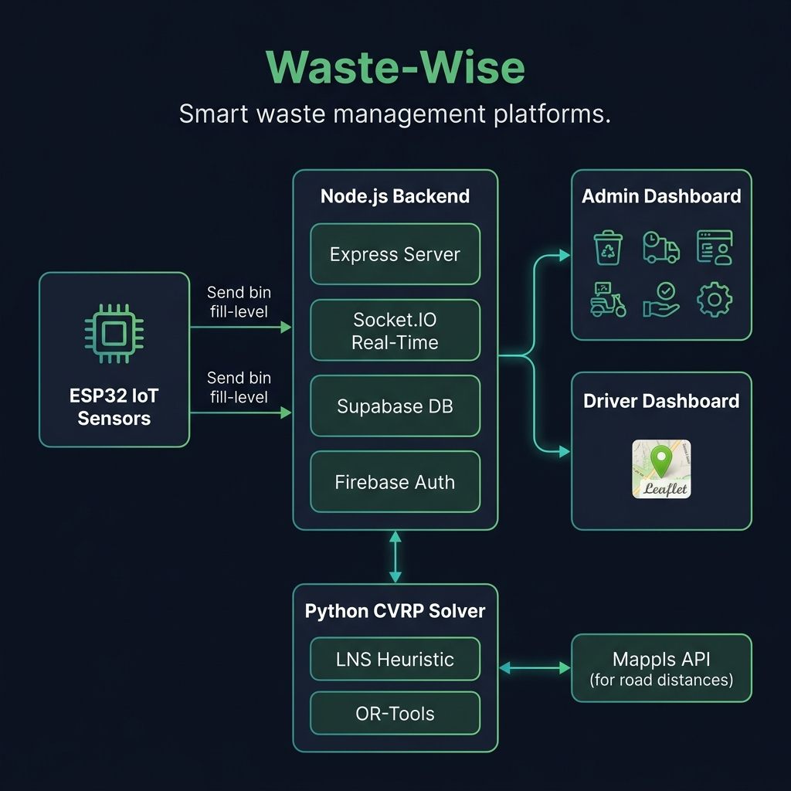

<div align="center">

# ♻️ Waste-Wise

### Smart Logistics & CVRP Routing Platform

*Full-stack waste management with mathematical route optimization, real-time IoT, and Firebase auth*

[](https://github.com/chahat1709/Waste-Wise)
[](https://developer.mozilla.org/en-US/docs/Web/JavaScript)
[](https://python.org)
[](https://firebase.google.com/)

</div>

---

## ΓÜí What is Waste-Wise?

Waste-Wise is a **full-stack waste management and logistics platform** that solves one of operations research's hardest problems ΓÇö the **Capacitated Vehicle Routing Problem (CVRP)** ΓÇö and connects the mathematical solver to a real-time IoT monitoring system.

Instead of using manual route planning or blocking batch jobs, Waste-Wise implements:
- **Dual CVRP solver** ΓÇö custom Large Neighborhood Search (LNS) heuristic + Google OR-Tools integration
- **Real-time IoT ingestion** from ESP32 sensors monitoring bin fill levels
- **Event-driven rerouting** via Socket.IO for instant fleet adaptation
- **Full auth system** with Firebase Authentication and Supabase persistence

> **Built by a 17-year-old, entirely self-taught systems engineer.**

---

## 🔬 Research Context

| | |
|---|---|
| **Problem** | Monolithic solvers for CVRP execute as blocking batch jobs, incapable of adapting dynamically to real-time IoT trigger events |
| **Hypothesis** | An event-driven architecture coupling a Python LNS heuristic directly to a Socket.IO real-time event bus will enable near-instantaneous stateful fleet rerouting |
| **Goal** | Reduce dynamic fleet rerouting latency by >85% compared to traditional cron-job implementations |
| **Status** | Dual solver operational with real-time dashboard. Mappls road-distance API integrated with Haversine fallback |

---

## 🏗️ Architecture

<div align="center">



</div>

### System Flow

```
ΓöîΓöÇΓöÇΓöÇΓöÇΓöÇΓöÇΓöÇΓöÇΓöÇΓöÇΓöÇΓöÇΓöÇΓöÇΓöÉ        ΓöîΓöÇΓöÇΓöÇΓöÇΓöÇΓöÇΓöÇΓöÇΓöÇΓöÇΓöÇΓöÇΓöÇΓöÇΓöÇΓöÇΓöÇΓöÇΓöÇΓöÇΓöÇΓöÇΓöÇΓöÇΓöÇΓöÇΓöÇΓöÇΓöÇΓöÇΓöÇΓöÇΓöÇΓöÇΓöÇΓöÇΓöÉ
Γöé  ESP32 IoT   ΓöéΓöÇΓöÇΓöÇΓöÇΓöÇΓöÇΓöÇΓû╢Γöé        NODE.JS BACKEND              Γöé
Γöé  Sensors     Γöé  data  Γöé  ΓöîΓöÇΓöÇΓöÇΓöÇΓöÇΓöÇΓöÇΓöÇΓöÇΓöÇΓöÇΓöÇΓöÇΓöÇΓöÇΓöÇΓöÇΓöÇΓöÇΓöÇΓöÇΓöÇΓöÇΓöÇΓöÇΓöÇΓöÇΓöÇΓöÇΓöÇΓöÉ  Γöé
Γöé  (bin fill)  Γöé        Γöé  Γöé Express Server (1000+ lines) Γöé  Γöé
ΓööΓöÇΓöÇΓöÇΓöÇΓöÇΓöÇΓöÇΓöÇΓöÇΓöÇΓöÇΓöÇΓöÇΓöÇΓöÿ        Γöé  Γö£ΓöÇΓöÇΓöÇΓöÇΓöÇΓöÇΓöÇΓöÇΓöÇΓöÇΓöÇΓöÇΓöÇΓöÇΓöÇΓöÇΓöÇΓöÇΓöÇΓöÇΓöÇΓöÇΓöÇΓöÇΓöÇΓöÇΓöÇΓöÇΓöÇΓöÇΓöñ  Γöé
                        Γöé  Γöé Socket.IO Real-Time Events   Γöé  Γöé
                        Γöé  Γö£ΓöÇΓöÇΓöÇΓöÇΓöÇΓöÇΓöÇΓöÇΓöÇΓöÇΓöÇΓöÇΓöÇΓöÇΓöÇΓöÇΓöÇΓöÇΓöÇΓöÇΓöÇΓöÇΓöÇΓöÇΓöÇΓöÇΓöÇΓöÇΓöÇΓöÇΓöñ  Γöé
                        Γöé  Γöé Supabase (Persistence)       Γöé  Γöé
                        Γöé  Γö£ΓöÇΓöÇΓöÇΓöÇΓöÇΓöÇΓöÇΓöÇΓöÇΓöÇΓöÇΓöÇΓöÇΓöÇΓöÇΓöÇΓöÇΓöÇΓöÇΓöÇΓöÇΓöÇΓöÇΓöÇΓöÇΓöÇΓöÇΓöÇΓöÇΓöÇΓöñ  Γöé
                        Γöé  Γöé Firebase Auth (Sessions)     Γöé  Γöé
                        Γöé  ΓööΓöÇΓöÇΓöÇΓöÇΓöÇΓöÇΓöÇΓöÇΓöÇΓöÇΓöÇΓöÇΓöÇΓöÇΓöÇΓöÇΓöÇΓöÇΓöÇΓöÇΓöÇΓöÇΓöÇΓöÇΓöÇΓöÇΓöÇΓöÇΓöÇΓöÇΓöÿ  Γöé
                        ΓööΓöÇΓöÇΓöÇΓöÇΓöÇΓöÇΓöÇΓöÇΓöÇΓö¼ΓöÇΓöÇΓöÇΓöÇΓöÇΓöÇΓöÇΓöÇΓöÇΓöÇΓöÇΓöÇΓöÇΓöÇΓö¼ΓöÇΓöÇΓöÇΓöÇΓöÇΓöÇΓöÇΓöÇΓöÇΓöÇΓöÇΓöÿ
                                  Γöé              Γöé
                    ΓöîΓöÇΓöÇΓöÇΓöÇΓöÇΓöÇΓöÇΓöÇΓöÇΓöÇΓöÇΓöÇΓöÇΓû╝ΓöÇΓöÇΓöÉ    ΓöîΓöÇΓöÇΓöÇΓöÇΓöÇΓöÇΓû╝ΓöÇΓöÇΓöÇΓöÇΓöÇΓöÇΓöÇΓöÇΓöÇΓöÇΓöÉ
                    Γöé ADMIN DASHBOARD Γöé    Γöé DRIVER DASHBOARD Γöé
                    Γöé Fleet Mgmt     Γöé    Γöé Leaflet Maps     Γöé
                    Γöé Route Assign   Γöé    Γöé Collection Logs  Γöé
                    Γöé Bin Monitoring  Γöé    Γöé Hazard Alerts    Γöé
                    ΓööΓöÇΓöÇΓöÇΓöÇΓöÇΓöÇΓöÇΓöÇΓöÇΓöÇΓöÇΓöÇΓöÇΓöÇΓöÇΓöÇΓöÿ    ΓööΓöÇΓöÇΓöÇΓöÇΓöÇΓöÇΓöÇΓöÇΓöÇΓöÇΓöÇΓöÇΓöÇΓöÇΓöÇΓöÇΓöÇΓöÿ
                                  Γöé
                    ΓöîΓöÇΓöÇΓöÇΓöÇΓöÇΓöÇΓöÇΓöÇΓöÇΓöÇΓöÇΓöÇΓöÇΓû╝ΓöÇΓöÇΓöÇΓöÇΓöÇΓöÇΓöÇΓöÇΓöÇΓöÇΓöÇΓöÇΓöÇΓöÇΓöÇΓöÇΓöÇΓöÇΓöÉ
                    Γöé     PYTHON CVRP SOLVER          Γöé
                    Γöé  ΓöîΓöÇΓöÇΓöÇΓöÇΓöÇΓöÇΓöÇΓöÇΓöÇΓöÇΓöÇΓöÉ  ΓöîΓöÇΓöÇΓöÇΓöÇΓöÇΓöÇΓöÇΓöÇΓöÇΓöÇΓöÇΓöÇΓöÉ Γöé
                    Γöé  Γöé LNS       Γöé  Γöé Google     Γöé Γöé
                    Γöé  Γöé Heuristic Γöé  Γöé OR-Tools   Γöé Γöé
                    Γöé  ΓööΓöÇΓöÇΓöÇΓöÇΓöÇΓöÇΓöÇΓöÇΓöÇΓöÇΓöÇΓöÿ  ΓööΓöÇΓöÇΓöÇΓöÇΓöÇΓöÇΓöÇΓöÇΓöÇΓöÇΓöÇΓöÇΓöÿ Γöé
                    Γöé  Mappls API ΓùäΓöÇΓöÇ Haversine       Γöé
                    ΓööΓöÇΓöÇΓöÇΓöÇΓöÇΓöÇΓöÇΓöÇΓöÇΓöÇΓöÇΓöÇΓöÇΓöÇΓöÇΓöÇΓöÇΓöÇΓöÇΓöÇΓöÇΓöÇΓöÇΓöÇΓöÇΓöÇΓöÇΓöÇΓöÇΓöÇΓöÇΓöÇΓöÇΓöÿ
```

---

## 🎯 Core Features

| Feature | Description |
|---------|-------------|
| **Dual CVRP Solver** | Custom LNS heuristic + Google OR-Tools for capacitated vehicle routing |
| **Real-Time IoT** | ESP32 sensor data ingestion for live bin fill-level monitoring |
| **Event-Driven Rerouting** | Socket.IO event bus triggers instant fleet re-optimization |
| **Admin Dashboard** | Full fleet management, route assignment, and bin monitoring panel |
| **Driver Dashboard** | Real-time Leaflet maps, route visualization, collection confirmation |
| **Auth System** | Firebase Authentication with HTTP-only session cookies |
| **Road Distance API** | Mappls (MapmyIndia) integration with Haversine fallback |

---

## 📂 Project Structure

```
Waste-Wise/
Γö£ΓöÇΓöÇ server.js              # Node.js Express backend (1000+ lines)
Γö£ΓöÇΓöÇ app.js                 # App initialization
Γö£ΓöÇΓöÇ cvrp_solver.py         # Python CVRP solver (LNS + OR-Tools)
Γö£ΓöÇΓöÇ config.js              # Server configuration
Γö£ΓöÇΓöÇ firebase-Config.js     # Firebase configuration
Γö£ΓöÇΓöÇ firebase-auth.js       # Authentication logic
Γö£ΓöÇΓöÇ firebase-config-unified.js  # Unified Firebase config
Γö£ΓöÇΓöÇ login-auth.js          # Login authentication
Γö£ΓöÇΓöÇ signup-auth.js         # Signup authentication
Γö£ΓöÇΓöÇ dashboard.html         # Driver dashboard
Γö£ΓöÇΓöÇ dashboard.js           # Dashboard logic
Γö£ΓöÇΓöÇ dashboard.css          # Dashboard styles
Γö£ΓöÇΓöÇ admindashboard.html    # Admin dashboard
Γö£ΓöÇΓöÇ adminDashboard.js      # Admin dashboard logic
Γö£ΓöÇΓöÇ admin.html             # Admin panel
Γö£ΓöÇΓöÇ admin.js               # Admin logic
Γö£ΓöÇΓöÇ binStatus.html         # Bin status monitor
Γö£ΓöÇΓöÇ binstatus.js           # Bin status logic
Γö£ΓöÇΓöÇ GaugeView.js           # Visual gauge components
Γö£ΓöÇΓöÇ index.html             # Landing page
Γö£ΓöÇΓöÇ login.html             # Login page
Γö£ΓöÇΓöÇ signup.html            # Signup page
Γö£ΓöÇΓöÇ Translate.js           # Multi-language support
Γö£ΓöÇΓöÇ requirements.txt       # Python dependencies
ΓööΓöÇΓöÇ package.json           # Node.js dependencies
```

---

## 🛠️ Tech Stack

| Layer | Technology | Purpose |
|-------|-----------|---------|
| **Algorithm** | Python (LNS, OR-Tools, Haversine) | CVRP route optimization |
| **Backend** | Node.js, Express, Socket.IO | Real-time server & API |
| **Database** | Supabase | Persistent data storage |
| **Auth** | Firebase Admin SDK | User authentication & sessions |
| **Frontend** | Vanilla JS, Leaflet.js, HTML5/CSS3 | Dashboards & maps |
| **IoT** | ESP32 | Sensor data from smart bins |
| **Maps** | Mappls (MapmyIndia) API | Road distance calculations |

---

## 🚀 Quick Start

### Prerequisites
- **Node.js** 18+
- **Python** 3.10+
- **Firebase** project with Authentication enabled
- **Supabase** project with database configured

### Setup

```bash
# Clone the repository
git clone https://github.com/chahat1709/Waste-Wise.git
cd Waste-Wise

# Install Node.js dependencies
npm install

# Install Python dependencies (for CVRP solver)
pip install -r requirements.txt

# Configure Firebase
# Edit firebase-Config.js with your Firebase project credentials

# Start the server
node server.js
```

Then open `http://localhost:3000` in your browser.

---

---

## API Summary

| Method | Path | Purpose |
|--------|------|---------|
| GET | `/health` | Health check |
| GET | `/api/config` | Public Firebase config |
| POST | `/sessionLogin` `{idToken}` | Create `ww_session` cookie |
| GET | `/sessionLogout` | Clear session |
| POST | `/updateBin` `{id,fullness,weight,temp,...}` | ESP32 ingest → emits `binData`, `fullnessAlert`, `rerouteSuggestion` |
| GET | `/bins`, `/bins/:id`, POST `/bins` | Bin CRUD (Supabase + memory fallback) |
| GET | `/nearby-bins?lat&lng&r` | BBOX query (unified endpoint) |
| POST | `/assign-route` `{driverId,bins,startLocation}` | Create route → `routeAssigned` |
| GET | `/driver/:id/route` | Active route |
| POST | `/driver/:id/location` `{lat,lng}` | Tracking → `driverLocation` |
| POST | `/route/:id/collect` `{binId,driverId}` | Collection → `binCollected` |
| POST | `/optimize-route` / `/api/optimize-routes` | Heuristic optimizer |
| POST | `/api/cvrp` | Python LNS/OR-Tools solver (with JS fallback) |
| GET | `/alerts?type&binId` | Alert history |
| POST | `/provision`, GET `/provision/:binId`, POST `/provision/:binId/ack` | ESP32 provisioning |
| POST | `/devices/register` | FCM token store |

## Frontend Routes

- `/index.html` → role gate (Admin → `adminlogin.html` or inline Firebase; Driver → `login.html`)
- `/login.html` → `login-auth.js:1` (Firebase + `ww_session`)
- `/dashboard.html` → driver map + Smart Route (`dashboard.js:1`)
- `/binStatus.html?binId=xyz` → gauges + live socket (`binstatus.js:1`)
- `/admindashboard.html` → admin fleet (`adminEnhanced.js:1`)
- `/admin.html` → alternative admin portal (`admin.js:1`)
- `/adminlogin.html` → demo + Firebase fallback (`adminlogin.js:1`)

## Environment

See `.env.example` ΓÇö all `FIREBASE_*` exposed via `/api/config`. `SUPABASE_URL/KEY` server-only but also used client-side for direct queries (anon key). Missing Supabase gracefully falls back to in-memory stores (alerts, bins, routes) so the app remains demoable offline.

## 📝 License

Research & Educational Use

---

<div align="center">

**Built with obsession by [Chahat Jain](https://github.com/chahat1709)**

*17-year-old self-taught systems engineer | India*

[LinkedIn](https://www.linkedin.com/in/chahat-jain-20873b377) ┬╖ [GitHub](https://github.com/chahat1709) ┬╖ [Email](mailto:chahatjain0-96@gmail.com)

</div>
